<p align="center">
  
</p>

<p align="center">
  <a href="https://github.com/saihroo">
    
  </a>
</p>

<p align="center">
  
  
  
  
</p>

---

## `$ whoami`

I build complete products — web, mobile, desktop and games. I care about clean architecture, performance, and the small details that make software feel alive.

Right now I'm building **KOMA**, a local-first manga motion studio, and prototyping **Hushmark**, a co-op horror game on Roblox.

<sub><b>ES</b> — Construyo productos completos: web, móvil, escritorio y juegos. Me importan la arquitectura limpia, el rendimiento y esos detalles que hacen que el software se sienta vivo.</sub>

---

## `$ cat now.txt`

```yaml
building:   KOMA — a local-first manga motion studio
tinkering:  Saihroo — a terminal coding agent
learning:   motion systems · local AI · Android
open_to:    ambitious products & good collaborations
```

<sub><b>ES</b> — Construyendo KOMA, experimentando con Saihroo y abierto a productos ambiciosos y buenas colaboraciones.</sub>

---

## `$ tree stack/`

```txt
saihroo@github:~$ tree stack/
stack/
├── web/        TypeScript · JavaScript · React · Next.js
├── mobile/     Kotlin · Android
├── backend/    C# · .NET · Node.js · MySQL · SQL Server
├── ai/         Python · Ollama · OpenAI-compatible APIs
├── gamedev/    Roblox · Luau · Rojo
└── tools/      Git · GitHub · Linux · Electron · Vite
```

<p align="center">
  <picture>
    <source media="(prefers-color-scheme: dark)" srcset="https://skillicons.dev/icons?i=ts%2Cjs%2Creact%2Cnextjs%2Cnodejs%2Ckotlin%2Candroidstudio%2Cpython%2Ccs%2Cdotnet%2Cmysql%2Cgit%2Cgithub%2Clinux%2Clua%2Celectron%2Cvite&amp;theme=dark&amp;perline=9" />
    <source media="(prefers-color-scheme: light)" srcset="https://skillicons.dev/icons?i=ts%2Cjs%2Creact%2Cnextjs%2Cnodejs%2Ckotlin%2Candroidstudio%2Cpython%2Ccs%2Cdotnet%2Cmysql%2Cgit%2Cgithub%2Clinux%2Clua%2Celectron%2Cvite&amp;theme=light&amp;perline=9" />
    
  </picture>
</p>

---

## `$ ls projects/`

### 01 · Saihroo
**Terminal coding agent** · `Node.js` `DeepSeek` `NVIDIA API` `CLI`

A hackable terminal agent that reads files, edits code, runs PowerShell, searches the web, keeps todo lists and resumes sessions. Single Node.js package, zero runtime dependencies.

### 02 · KOMA
**Manga motion studio** · `Electron` `JavaScript` `Local AI` `Windows`

Turns manga panels into motion comics: camera moves, parallax, character rigging, particles and beat-synced music. Everything runs locally; AI direction is optional through Ollama or any OpenAI-compatible API.

### 03 · Hushmark
**Co-op horror game** · `Roblox` `Luau` `Rojo`

A 1–4 player survival experience where the monster steals your voice and noise is the core resource. Built with a networked module architecture, rate limiting and server-side validation.

### 04 · Mediscan
**Medical appointment platform** · `C#` `.NET` `SQL`

Scheduling, role-based access and a clean domain model designed to keep clinic workflows simple.

<sub>Most of this work lives in private repositories. Happy to walk through the architecture, the decisions or a live demo on request.</sub>

<sub><b>ES</b> — La mayoría de estos proyectos están en repositorios privados. Con gusto te cuento la arquitectura, las decisiones o te muestro una demo.</sub>

---

## `$ git log --graph`

<p align="center">
  <picture>
    <source media="(prefers-color-scheme: dark)" srcset="https://raw.githubusercontent.com/saihroo/saihroo/output/github-snake-dark.svg" />
    <source media="(prefers-color-scheme: light)" srcset="https://raw.githubusercontent.com/saihroo/saihroo/output/github-snake.svg" />
    
  </picture>
  <br />
  <sub>Auto-generated every day from my contribution graph · <a href="https://github.com/saihroo?tab=repositories">browse repositories →</a></sub>
</p>

---

## `$ contact --now`

Have an idea, a product to build, or a codebase that needs a second pair of eyes? My inbox is open.

<sub><b>ES</b> — ¿Tienes una idea, un producto que construir o un proyecto que necesita otra mirada? Escríbeme.</sub>

<p align="center">
  <a href="mailto:samuelisaachuembes@gmail.com">
    
  </a>
  <a href="https://github.com/saihroo">
    
  </a>
</p>

---

<p align="center">
  <sub><i>“Simplicity is prerequisite for reliability.” — Edsger W. Dijkstra</i></sub>
  <br />
  <sub>Designed &amp; built by saihroo · <code>main</code></sub>
</p>
