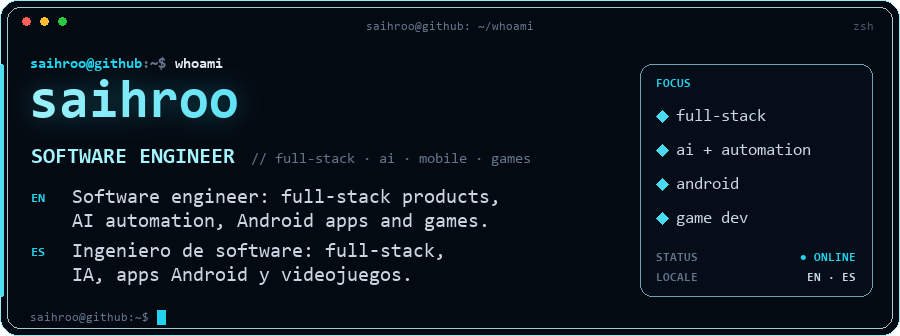

 

<b>EN</b> — Software Engineer. Full-stack, AI, mobile and game development. 
<b>ES</b> — Ingeniero de Software. Full-stack, IA, móvil y desarrollo de videojuegos.

  

---

## `$ whoami`

  

---

## `$ stack --list`

<table cellpadding="14">
  <thead>
    <tr>
      <th colspan="2" align="left"><code>saihroo@github:~$ cat tech-stack.yaml</code></th>
    </tr>
  </thead>
  <tbody>
    <tr>
      <td width="50%" valign="top">
        <code>├─ 01 frontend</code>  
        &nbsp;&nbsp;
        &nbsp;&nbsp;
        
          
        <code>TypeScript · JavaScript · React</code> 
      </td>
      <td width="50%" valign="top">
        <code>├─ 02 mobile</code>  
        &nbsp;&nbsp;
        
          
        <code>Kotlin · Android</code> 
      </td>
    </tr>
    <tr>
      <td valign="top">
        <code>├─ 03 ai_automation</code>  
        &nbsp;&nbsp;
        
          
        <code>Python · AI · Automation</code>
      </td>
      <td valign="top">
        <code>├─ 04 backend_data</code>  
        &nbsp;&nbsp;
        
          
        <code>C# · .NET · SQL</code>
      </td>
    </tr>
    <tr>
      <td valign="top">
        <code>├─ 05 gamedev</code>  
        &nbsp;&nbsp;
        
          
        <code>Roblox · Luau</code>
      </td>
      <td valign="top">
        <code>╰─ 06 tooling</code>  
        &nbsp;&nbsp;
        &nbsp;&nbsp;
        
          
        <code>Git · GitHub · Linux</code>
      </td>
    </tr>
  </tbody>
  <tfoot>
    <tr>
      <td colspan="2"><code>status: online&nbsp;&nbsp;·&nbsp;&nbsp;mode: building&nbsp;&nbsp;·&nbsp;&nbsp;locale: en / es</code></td>
    </tr>
  </tfoot>
</table>

---

## `$ gh stats --user saihroo`

  

<code>commits · pull requests · issues</code>

---

## `$ snake --contributions`

  <picture>
    <source media="(prefers-color-scheme: dark)" srcset="https://raw.githubusercontent.com/saihroo/saihroo/refs/heads/output/snake-dark.svg?v=3" />
    <source media="(prefers-color-scheme: light)" srcset="https://raw.githubusercontent.com/saihroo/saihroo/refs/heads/output/snake-light.svg?v=3" />
    
  </picture>

<code>contribution graph · snake loop</code>

---

  <code>saihroo · software engineer · 2026</code>

