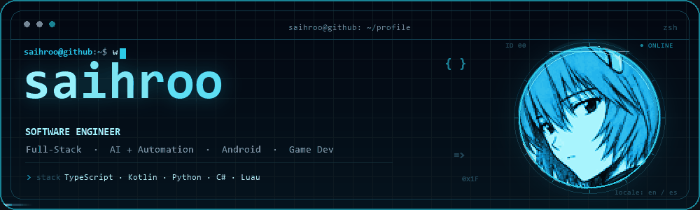
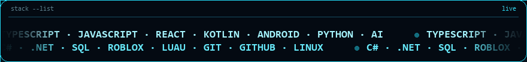
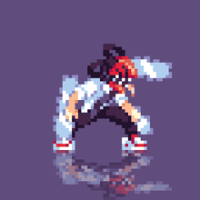

  

  

  <b>EN</b> — Software Engineer. Full-stack, AI, mobile and game development. 
  <b>ES</b> — Ingeniero de software. Full-stack, IA, móvil y desarrollo de juegos.

---

## `$ stack --list`

  

  <picture>
    <source media="(prefers-color-scheme: dark)" srcset="https://skillicons.dev/icons?i=ts%2Cjs%2Creact%2Cnextjs%2Cnodejs%2Ckotlin%2Candroidstudio%2Cpython%2Ccs%2Cdotnet%2Cmysql%2Cgit%2Cgithub%2Clinux%2Clua%2Celectron%2Cvite&amp;theme=dark&amp;perline=9" />
    <source media="(prefers-color-scheme: light)" srcset="https://skillicons.dev/icons?i=ts%2Cjs%2Creact%2Cnextjs%2Cnodejs%2Ckotlin%2Candroidstudio%2Cpython%2Ccs%2Cdotnet%2Cmysql%2Cgit%2Cgithub%2Clinux%2Clua%2Celectron%2Cvite&amp;theme=light&amp;perline=9" />
    
  </picture>

---

  
   
  idle loop · chainsaw man

