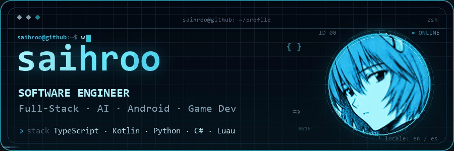
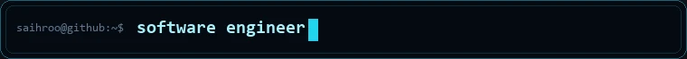
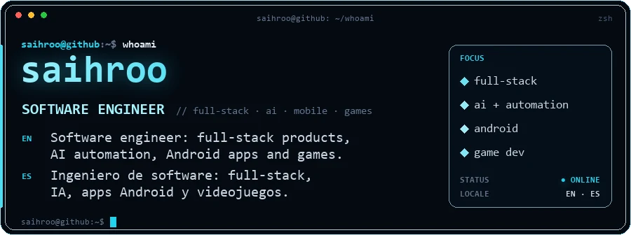
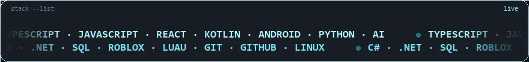
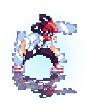

 

<b>EN</b> — Software Engineer. Full-stack, AI, mobile and game development. 
<b>ES</b> — Ingeniero de Software. Full-stack, IA, móvil y desarrollo de videojuegos.

  

### `$ whoami`

  

### `$ stack --list`

  

### `$ gh stats --user saihroo`

  

### `$ snake --contributions`

  <picture>
    <source media="(prefers-color-scheme: dark)" srcset="https://raw.githubusercontent.com/saihroo/saihroo/refs/heads/output/snake-dark.svg?v=3" />
    <source media="(prefers-color-scheme: light)" srcset="https://raw.githubusercontent.com/saihroo/saihroo/refs/heads/output/snake-light.svg?v=3" />
    
  </picture>

  

